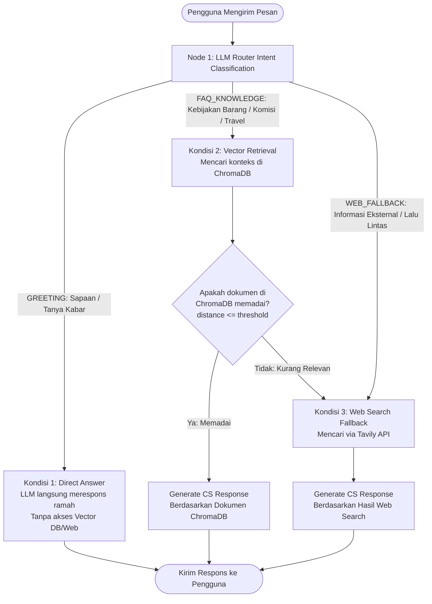

# Asisten AI FAQ Dea Trans Group (https://deatransgroup.com/)

Asisten AI operasional layanan pelanggan (Customer Service & FAQ) berbasis Python dan FastAPI untuk Website Resmi [Dea Trans Group](https://deatransgroup.com/). Sistem ini menggunakan alur logika bersyarat cerdas (Conditional Decision Graph / Router) yang mengoptimalkan latensi, biaya token, akurasi jawaban, dan kemampuan pencarian informasi eksternal terkini.

---

## 🧭 Alur Logika Bersyarat (Decision Workflow)

Sistem mengimplementasikan alur multi-node:



### 1. Node 1: Routing (Intent Classification)
Saat ada pertanyaan masuk, LLM bertindak sebagai **Router** untuk menganalisis dan mengklasifikasikan niat pengguna ke dalam 3 kategori:
* `GREETING`: Sapaan, salam, ucapan terima kasih, atau tanya kabar.
* `FAQ_KNOWLEDGE`: Pertanyaan operasional, kebijakan pengembalian barang, komisi afiliasi mitra tiket, armada travel, refund, reschedule, atau pengiriman paket Dea Trans Group.
* `WEB_FALLBACK`: Pertanyaan situasi terkini di luar SOP internal (e.g. kondisi macet jalan tol Cipali hari ini, berita lalu lintas terkini).

### 2. Kondisi 1: Direct Answer
Jika pengguna hanya menyapa (misal: *"Halo min apa kabar?"*, *"Selamat pagi"*), LLM **langsung menjawab ramah tanpa memicu pencarian database lokal maupun web search**, sehingga **sangat menghemat token dan waktu respons (sub-second latency)**.

### 3. Kondisi 2: Vector Retrieval (ChromaDB)
Jika pengguna bertanya tentang kebijakan pengembalian barang tertinggal, klaim paket rusak/hilang, maupun komisi afiliasi agen tiket travel, agen secara otomatis memicu tool pencarian konteks di dalam **Vector Database (ChromaDB)**.
- Koleksi: `deatrans_knowledge`
- Menyimpan SOP pengembalian barang (pelaporan 1x24 jam, masa simpan 30 hari di pool operasional), skema komisi agen travel (Rp 15.000 - Rp 25.000 / seat, pencairan mingguan tiap Senin), dan layanan travel door-to-door / carter drop.

### 4. Kondisi 3: Fallback (Tavily Web Search)
Jika dokumen di database lokal tidak memadai (skor jarak melebihi batas ambang `RETRIEVAL_DISTANCE_THRESHOLD`), agen **secara mandiri memutuskan** untuk menggunakan tool **Web Search (Tavily API)** untuk mencari informasi terbaru di internet terkait Dea Trans Group atau kondisi lalu lintas perjalanan.

---

## 📁 Struktur Direktori

```
AI-Assisten/
├── app/
│   ├── __init__.py
│   ├── main.py                  # Entry point FastAPI, CORS, Lifespan, Swagger UI
│   ├── config.py                # Konfigurasi Pydantic Settings & Environment
│   ├── schemas.py               # Pydantic Request/Response models
│   ├── core/
│   │   ├── __init__.py
│   │   ├── agent.py             # Orchestrator alur logika bersyarat (Router -> Direct/RAG/Fallback)
│   │   ├── router.py            # LLM Intent Classifier (GREETING, FAQ_KNOWLEDGE, WEB_FALLBACK)
│   │   └── llm.py               # Universal LLM Client (OpenAI API + Smart Fallback)
│   ├── services/
│   │   ├── __init__.py
│   │   ├── vector_db.py         # ChromaDB Persistent Client, Search, & Document Ingestion
│   │   └── web_search.py        # Tavily Web Search API client + Smart Web Fallback
│   ├── data/
│   │   ├── __init__.py
│   │   └── default_faq.py       # Knowledge base default Dea Trans Group
│   └── routes/
│       ├── __init__.py
│       ├── chat.py              # Endpoint POST /api/v1/chat
│       └── documents.py         # Endpoint POST /api/v1/documents (tambah FAQ dinamis)
├── tests/
│   ├── __init__.py
│   └── test_agent.py            # Test suite pytest untuk memvalidasi seluruh node
├── .env.example                 # Template variabel lingkungan
├── .gitignore                   # Konfigurasi Git ignore
├── requirements.txt             # Daftar dependensi Python
└── README.md                    # Dokumentasi lengkap
```

---

## 🚀 Panduan Instalasi & Menjalankan

### 1. Prasyarat
- Python 3.10 atau versi lebih baru
- Git

### 2. Clone Repository & Setup Virtual Environment
```bash
# Clone repository
git clone https://github.com/USERNAME/AI-Assisten.git
cd AI-Assisten

# Buat virtual environment
python -m venv venv

# Aktifkan virtual environment
# Di Windows:
venv\Scripts\activate
# Di Linux/macOS:
source venv/bin/activate
```

### 3. Instalasi Dependensi
```bash
pip install -r requirements.txt
```

### 4. Konfigurasi Variabel Lingkungan (.env)
Salin file `.env.example` menjadi `.env`:
```bash
copy .env.example .env
```
Isi API key Anda di file `.env`:
```env
OPENAI_API_KEY=sk-...your-openai-api-key...
OPENAI_MODEL=gpt-4o-mini
TAVILY_API_KEY=tvly-...your-tavily-api-key...
CHROMA_PERSIST_DIRECTORY=./chroma_db
RETRIEVAL_DISTANCE_THRESHOLD=0.85
APP_HOST=0.0.0.0
APP_PORT=8000
APP_DEBUG=True
```
> **Catatan:** Sistem telah dilengkapi *Smart Fallback Engine*. Jika API key OpenAI atau Tavily belum diisi, server tetap dapat berjalan dan mengembalikan jawaban cerdas untuk keperluan testing!

### 5. Menjalankan Server FastAPI
Jalankan server menggunakan Uvicorn:
```bash
uvicorn app.main:app --reload --host 0.0.0.0 --port 8000
```
Server akan aktif di:
- **API Base URL**: `http://localhost:8000`
- **Interactive Swagger UI Docs**: `http://localhost:8000/docs`
- **ReDoc Docs**: `http://localhost:8000/redoc`

---

## 📡 Dokumentasi Endpoint API

### 1. Chat & FAQ (`POST /api/v1/chat`)

Endpoint utama untuk mengirimkan pertanyaan ke Asisten AI.

#### Contoh Request: Sapaan (Kondisi 1 - Direct Answer)
```bash
curl -X POST "http://localhost:8000/api/v1/chat" \
     -H "Content-Type: application/json" \
     -d '{"message": "Halo min, selamat pagi apa kabar?"}'
```
**Response:**
```json
{
  "answer": "Halo Kak! Selamat pagi. Kabar kami sangat baik dan siap melayani kebutuhan perjalanan travel atau kiriman paket Anda bersama Dea Trans Group. Ada yang bisa kami bantu hari ini? 😊",
  "route_taken": "direct_greeting",
  "intent": "GREETING",
  "sources": [],
  "execution_time_ms": 12.5,
  "conversation_id": null
}
```

---

#### Contoh Request: Kebijakan Barang / Komisi Afiliasi (Kondisi 2 - Vector Retrieval)
```bash
curl -X POST "http://localhost:8000/api/v1/chat" \
     -H "Content-Type: application/json" \
     -d '{"message": "Bagaimana kebijakan pengembalian barang yang tertinggal di travel Dea Trans?"}'
```
**Response:**
```json
{
  "answer": "Halo Kak! Jika barang Kakak tertinggal di armada travel Dea Trans Group, segera laporkan ke Customer Care resmi atau datangi pool terdekat maksimal 1x24 jam dengan menyertakan kode booking tiket dan deskripsi barang. Barang akan disimpan dengan aman di pool hingga maksimal 30 hari kalender. Pengambilan barang di pool bebas biaya, atau dapat dikirimkan ke alamat Kakak dengan ongkir ditanggung pemilik. Info lengkap: https://deatransgroup.com/.",
  "route_taken": "vector_retrieval",
  "intent": "FAQ_KNOWLEDGE",
  "sources": [
    {
      "title": "Kebijakan Pengembalian Barang Tertinggal di Armada",
      "source": "https://deatransgroup.com/kebijakan-bagasi-barang",
      "category": "Kebijakan Barang & Bagasi",
      "snippet": "Kebijakan Pengembalian Barang Tertinggal di Armada Dea Trans Group: 1. Jika barang penumpang tertinggal di dalam unit armada travel...",
      "score": 0.892
    }
  ],
  "execution_time_ms": 145.2,
  "conversation_id": null
}
```

---

#### Contoh Request: Informasi Terkini / Eksternal (Kondisi 3 - Fallback Web Search)
```bash
curl -X POST "http://localhost:8000/api/v1/chat" \
     -H "Content-Type: application/json" \
     -d '{"message": "Apakah tol Cipali macet siang hari ini?"}'
```
**Response:**
```json
{
  "answer": "Halo Kak! Berdasarkan pantauan informasi terkini, armada Dea Trans Group tetap beroperasi normal dengan rute dinamis jika terdapat rekayasa lalu lintas di tol Cipali atau Trans Jawa. Untuk informasi update posisi perjalanan armada Anda, silakan hubungi Customer Care Dea Trans Group di https://deatransgroup.com/.",
  "route_taken": "web_search_fallback",
  "intent": "WEB_FALLBACK",
  "sources": [
    {
      "title": "Update Situasi Lalu Lintas & Operasional Dea Trans Group",
      "source": "https://deatransgroup.com/berita-operasional",
      "category": "Web Search",
      "snippet": "Informasi Operasional Dea Trans: Jadwal keberangkatan armada travel Dea Trans Group beroperasi normal 24 jam...",
      "score": 0.88
    }
  ],
  "execution_time_ms": 312.4,
  "conversation_id": null
}
```

---

### 2. Ingest Dokumen FAQ Baru (`POST /api/v1/documents`)
Menambahkan dokumen pengetahuan baru ke ChromaDB secara langsung.

```bash
curl -X POST "http://localhost:8000/api/v1/documents" \
     -H "Content-Type: application/json" \
     -d '{
       "documents": [
         {
           "title": "Syarat Sewa Mobil HiAce Premio",
           "category": "Rental Mobil",
           "content": "Penyewaan unit HiAce Premio Dea Trans Group sudah termasuk driver profesional dan BBM. Pemesanan wajib DP 30%.",
           "source": "https://deatransgroup.com/sewa-hiace"
         }
       ]
     }'
```

---

### 3. Health Check (`GET /api/v1/health`)
Memeriksa status layanan dan konektivitas database vektor:
```json
{
  "status": "healthy",
  "service": "Dea Trans Group AI Assistant",
  "version": "1.0.0",
  "vector_db_connected": true,
  "total_documents": 5
}
```

---

## 🧪 Menjalankan Pengujian Otomatis (Tests)

Jalankan test suite menggunakan pytest:
```bash
python -m pytest tests/ -v
```

---

## 🐙 Pengelolaan Versi di Git & GitHub

Repository ini sudah siap dikelola di GitHub:

```bash
# Inisialisasi git jika belum
git init

# Tambahkan seluruh file ke staging
git add .

# Buat commit awal
git commit -m "feat: inisialisasi asisten AI FAQ Dea Trans Group dengan alur logika bersyarat (Router, Direct Answer, ChromaDB RAG, Tavily Web Search Fallback)"

# Sambungkan ke remote repository GitHub Anda:
git remote add origin https://github.com/<USERNAME-ANDA>/<NAMA-REPO-ANDA>.git
git branch -M main
git push -u origin main
```

---

## 🏢 Tentang Dea Trans Group
Website Resmi: [https://deatransgroup.com/](https://deatransgroup.com/)  
Layanan: Travel Door to Door, Shuttle Antarkota, Rental Pariwisata, Titipan Kilat & Kemitraan Agen.

